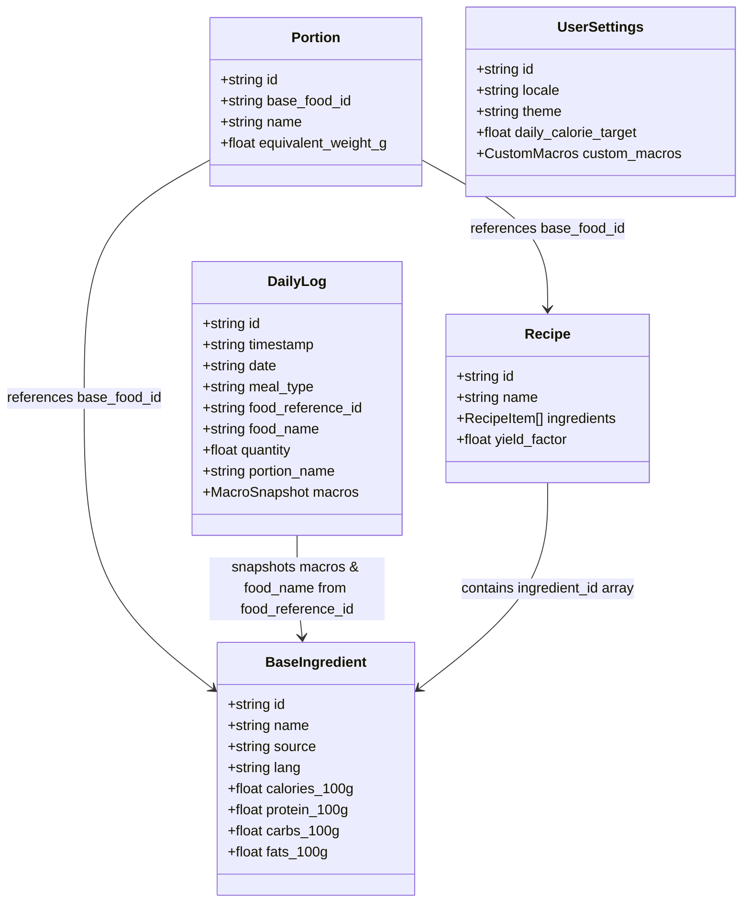
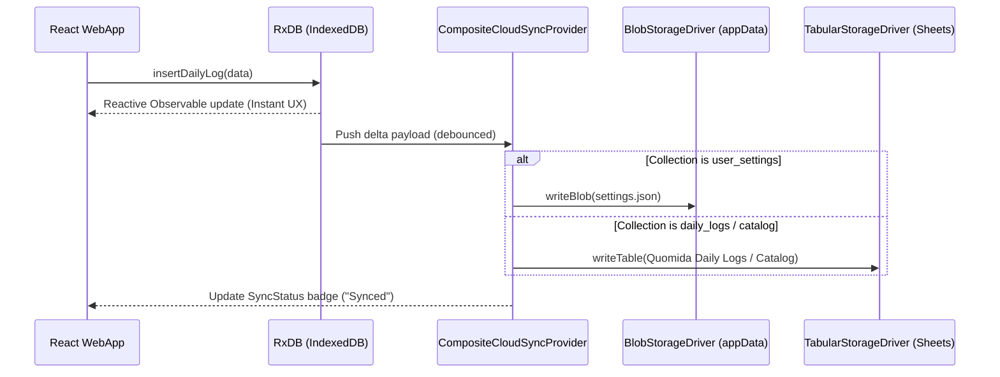

# 🏗️ Quomida System Architecture Blueprint

**Version:** 1.5  
**Architectural Style:** Monorepo, Local-First, Bring Your Own Storage (BYOS), Isomorphic TypeScript

---

## 1. System Overview

Quomida is a privacy-first, local-first web application designed for zero-latency calorie and macronutrient tracking. It eliminates client-side server dependency by storing all user state locally in **RxDB (IndexedDB)** and replicating changes asynchronously to the user's personal storage (Google Drive / Sheets). Service Worker PWA support ensures full cold-start offline shell availability.

```mermaid
graph TD
    subgraph Client Application (Browser / PWA)
        SW[Service Worker / Cache Storage] -->|Serves App Shell Offline| UI[React 19 WebApp]
        UI -->|Queries & Mutates| Repo[Domain Core Repository]
        Repo -->|RxDB API| DB[(Local RxDB Engine / IndexedDB)]
        DB -->|Native Observables| UI
    end

    subgraph BYOS Persistence Adapter
        DB -->|Delta Replication| CloudSyncProvider[CloudSyncProvider Interface]
        CloudSyncProvider -->|Mock / Test| MockSync[MockCloudSyncProvider]
        CloudSyncProvider -->|Production| GSheetsSync[GoogleDriveSheetsCloudSyncProvider]
    end

    subgraph User Personal Storage
        GSheetsSync -->|HTTPS / REST| Drive[(User Google Drive / Sheets)]
    end
```

---

## 2. Monorepo Package Architecture

Quomida operates as a clean monorepo structured to ensure complete isolation between domain logic, persistence adapters, and presentation:

```
quomida/
├── packages/
│   ├── domain-core/        # Isomorphic TS logic: RxDB JSON schemas, formulas, MealService & offline parser
│   ├── cloud-providers/    # CloudSyncProvider interface, MockCloudSyncProvider, Google Drive adapter
│   ├── ai-services/        # Optional external AI adapters (LlmRecipeDecomposer, AiKeyEncryptionService)
│   └── i18n-locales/       # Centralized localization keys (es.json, en.json)
├── apps/
│   ├── webapp/             # React 19 + Vite + Tailwind PWA with glassmorphic mobile UI
│   ├── etl-pipeline/       # Node.js ETL pipeline normalizing LATINFOODS/ARGENFOODS/USDA datasets
│   └── cli/                # Terminal CLI for offline catalog inspection & domain testing
```

### Dependency Rules & Constraints
1. **`packages/domain-core`**: MUST remain strictly isomorphic. ZERO DOM dependencies, zero UI framework dependencies, zero network calls, and zero external AI SDK imports. Houses the pure domain `MealService` and `StandardMealParser`.
2. **`packages/cloud-providers`**: Communicates strictly via `SyncDeltaPayload` objects.
3. **`packages/ai-services`**: Houses external AI adapters (`LlmRecipeDecomposer`, `AiKeyEncryptionService`), consuming `@qozara/ai-client` and implementing the `IRecipeDecomposer` domain port.
4. **`apps/webapp`**: Consumes `@quomida/domain-core` for pure domain orchestration and optionally injects adapters from `@quomida/cloud-providers` and `@quomida/ai-services`.

---

## 3. Data Model & RxDB Schemas

RxDB serves as the primary cache and single source of truth for the application.



### Collections Breakdown
- **`base_ingredients`**: Edible portion normalized to 100g base.
- **`recipes`**: Compound meals applying cooking yield retention factors (FAO/INFOODS standard).
- **`portions`**: Domestic household portion unit mappings (e.g. 1 slice, 1 portion = 150g).
- **`daily_logs`**: Transactional ledger of consumed items. Hardcodes macro snapshots and food names at creation time for historical immutability.
- **`user_settings`**: Cross-device global preferences (`global_settings`).

---

## 4. BYOS Sync Flow Sequence



---

## 5. Design Patterns Applied

- **Storage Strategy Pattern**: Decouples remote storage formats across domains. `CompositeCloudSyncProvider` routes unformatted application configuration (`user_settings`) to `BlobStorageDriver` and tabular data (`daily_logs`, `base_ingredients`, `recipes`, `portions`) to `TabularStorageDriver`, enabling plug-and-play support for Google Drive, OneDrive, or Box.
- **Adapter Pattern**: Swappable storage backends (Mock storage for offline dev/tests vs Google Drive Sheets for production).
- **Repository Pattern**: Wraps RxDB collections into typed domain methods (`LocalDBService`).
- **Observer Pattern**: Native RxDB observables push live updates to React component state.
- **Isomorphic Domain Core**: Math calculations execute identically in Node.js (CLI/ETL) and Browser environments.

---

## 6. Offline PWA Shell & Heartbeat Architecture

- **PWA Service Worker**: Managed via `vite-plugin-pwa` (`generateSW`). Automatically precaches `index.html`, core JavaScript, CSS, and SVG icons. Serves navigation requests offline (`NetworkFirst` with cache fallback) and hashed assets (`CacheFirst`).
- **Heartbeat & Network Detection**: `AppContext` listens to browser `online`/`offline` window events and executes a periodic 30-second `HEAD /` ping to verify real server reachability. Updates status reactively to `'disconnected'` on connection drop or failed ping.
- **WCAG 2.2 Accessibility**: Header status badge uses an `sr-only` element inside an `aria-live="polite"` region to announce connectivity state changes to screen readers in English and Spanish.

---

## 7. Hybrid Smart-Escalation Meal Architecture

Quomida uses a hybrid natural language meal ingestion pipeline that cleanly separates linguistic syntax parsing from catalog resolution, re-allocating generative AI strictly as an optional culinary knowledge escalator:

1. **Modular Deterministic Parser (`StandardMealParser`)**:
   - Executes 100% locally in `packages/domain-core` with sub-millisecond latency (< 1ms) and zero API consumption.
   - Uses pluggable `ParserLocalePack` interfaces (`esLocalePack`, `enLocalePack`) encapsulating language-specific word numbers, canonical units, meal verbs, and conjunction rules.
   - Dynamically selects the active pack from App Settings (`userSettings.locale`), falling back cleanly to heuristic multi-pack detection if unconfigured.
2. **Deterministic Offline Recipe Decomposition (No AI Required)**:
   - When users log composite meals or multiple foods (e.g., *"milanesa con puré de papas"*, *"2 huevos revueltos con tostadas"*), the parser splits the clause into distinct items.
   - `BatchMealResolver` resolves each component against the local catalog and automatically synthesizes a composite Virtual Recipe proposal 100% offline.
3. **Master AI Toggle & Offline Graceful Degradation**:
   - `userSettingsSchema` includes `ai_settings.enabled`. When toggled off, Quomida operates in 100% private, local-first mode with zero external network requests.
   - If the device is offline or provider quotas are exhausted, meal parsing and multi-item recipe synthesis continue to work without interruption.
4. **Just-In-Time (JIT) Culinary LLM Decomposer (`LlmRecipeDecomposer`)**:
   - Triggers only when a single food query yields no catalog match (e.g., regional/cultural dishes like *"locro"*).
   - Prompts the LLM to decompose the dish into base agricultural staples (e.g. white corn, beans, beef, squash) with realistic gram weights in the user's language.
   - Resolves those base ingredients against the catalog to synthesize an editable Virtual Recipe with real calculated macronutrients, eliminating the dead-end *"Alimento no encontrado"* error state.

---

## 8. Hexagonal Dependency Inversion for AI Meal Services

Following Clean Hexagonal Architecture (Ports & Adapters):
- **Core Domain (`packages/domain-core`)**: Owns `MealService` and the `IRecipeDecomposer` interface (port). `MealService` runs 100% offline out-of-the-box with `StandardMealParser` and `BatchMealResolver`. It has zero knowledge of HTTP or AI SDKs.
- **AI Infrastructure Adapter (`packages/ai-services`)**: Owns `LlmRecipeDecomposer`, implementing `IRecipeDecomposer` using `@qozara/ai-client`.
- **Composition Root (`apps/webapp`)**: Dynamically passes `new LlmRecipeDecomposer(...)` into `new MealService({ decomposer })` only when AI features are enabled by the user. If disabled or offline, `MealService` operates cleanly without any AI adapter.

